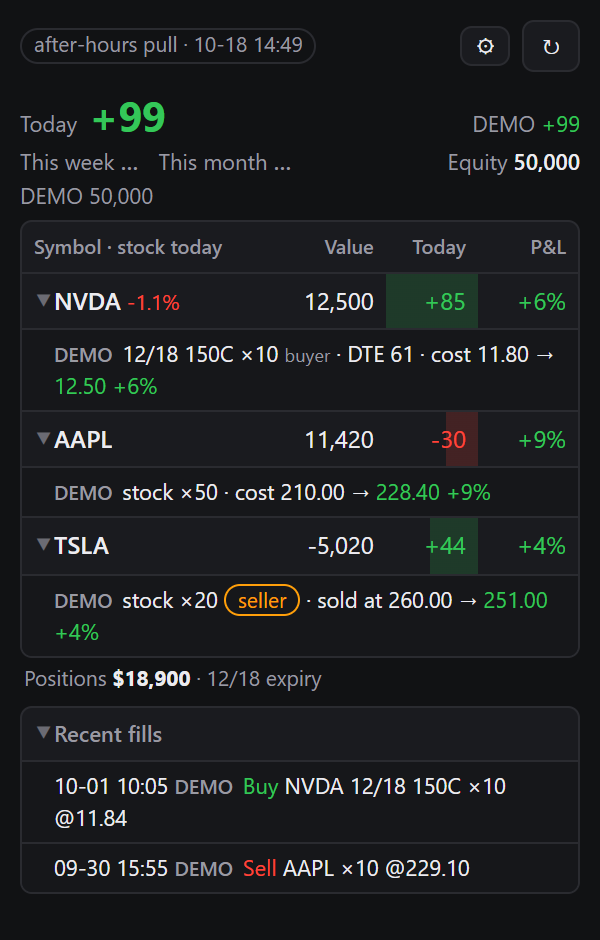
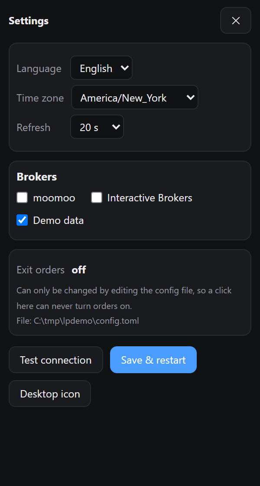

# Live Panel

A local, read-mostly positions panel for **moomoo / Futu** and **Interactive Brokers**, with a careful
one-click exit. Runs on your own machine and talks only to your broker's local gateway. It never sees your login
password; a trade password typed into 🔓 goes to OpenD as an MD5 and is not saved.

<p>
</p>

- Positions, today's P&L, this week / this month P&L (deposits stripped out), across several accounts, several
  moomoo logins and brokers — one row per symbol, every account's legs under it.
- Each option leg says whether you are **long** or **short** (中文: 买方 / 卖方), its dollar P&L and days to expiry;
  legs about to expire are flagged. A login that is offline keeps its last-seen positions on screen, greyed —
  not shown is not closed.
- Freezes on closing marks after the bell instead of re-pulling quotes that can't change.
- Exit (off by default): press 🧹 **Exit**, pick legs on its own page — options and stock in separate sections, one
  tick for a symbol across every login — with live bid / ask and the first price shown, confirm a list of exactly
  what will be sent. Limit orders only: sell to close from the bid + 70% of the spread, buy to close from the
  ask − 70%, one tick toward the far side every 10 s, never past it (both numbers are settings). Afterwards it
  re-reads the positions and says **"All closed"** or what is still held.

> **Status**
> - moomoo: read side verified against a real OpenD, including two different logins on one computer at once.
> - Exit engine: tested against a simulated broker and rehearsed on live quotes; first live use on 2026-10-19 by the author,
>   on three moomoo accounts across two logins (long options and stock, sold to close) — every leg filled and the
>   re-read showed them closed. That is one evening, not a track record: rehearse first. Unlocking with 🔓 has worked on a real
>   command-line OpenD.
> - IBKR: written against `ib_async` and tested against a fake gateway. **Not yet run against a real TWS / IB Gateway.**
> - Crypto exchanges: not supported yet (the data model has room for it).

## Connect your broker

### moomoo / Futu
1. Install and log in to **OpenD** (the GUI version is simplest).
2. First time only: complete the *API questionnaire and agreements* in your moomoo account.
3. `pip install moomoo-api`
4. In `config.toml`: `use = ["moomoo"]`. Default address `127.0.0.1:11111`.
5. Quotes: US options L1 is free if your account has assets or US positions; otherwise buy OPRA.
6. Live orders need the login unlocked: the GUI OpenD's *Unlock* button (top right), or 🔓 in the panel.

Accounts are discovered automatically. A universal account's futures sub-account is added to its equity.

#### Several moomoo logins in one panel
One OpenD serves one login, so each login needs its own OpenD on its own port. List them in the config:

```toml
[[moomoo.logins]]
label = "Main"      # shown in the panel as "Main·SG"; at most 12 characters, no spaces or "-"
port = 11111
[[moomoo.logins]]
label = "Acct2"
port = 11112
```

Positions in the same underlying are grouped together across logins, and one exit closes the legs in every
login (each order goes to the login that holds it). Unlock trading in each OpenD.

The settings page (⚙) writes these for you. Tried with two real logins on one Windows computer:

1. Download OpenD once. Copy its **command-line** folder (not the GUI one) once per extra login.
2. In each copy's `OpenD.xml`, set a different `api_port` (11112, 11113 …).
3. Start `OpenD.exe` in that folder and log in. OpenD 10.10 and newer ask for the account and password in the
   window; older ones read them from `OpenD.xml` (plain text — delete it when you're done).
4. A new computer asks for an SMS code: type `req_phone_verify_code`, then `input_phone_verify_code -code=123456`.
5. Each account must have done moomoo's API questionnaire once
   ([moomoo.com/about/api-disclaimer](https://www.moomoo.com/about/api-disclaimer)); otherwise OpenD logs in and exits.
6. Keep every OpenD window open (minimized is fine). The command-line OpenD has no *Unlock* button: use 🔓 in the panel.

Give a login its OpenD's location (`opend = '…\OpenD.exe'`, or the box on the settings page) and the panel starts
that OpenD when it isn't running — at start-up, and again within five minutes if it gets closed. It opens minimized;
logging in is OpenD's own business (its saved login), so a login that needs an SMS code still needs you once.

If one OpenD is closed, that login shows "OpenD not reachable" and the others keep working; week / month wait
until it is back, because the total would be wrong without it. A login added later gets `since = "YYYY-MM-DD"`
(the settings page adds it): its balance on that day counts as a deposit, not as profit.

### Interactive Brokers
1. Install TWS or IB Gateway and log in.
2. *Configure → API → Settings*: tick **Enable ActiveX and Socket Clients**.
3. Port: TWS 7496 live / 7497 paper, Gateway 4001 live / 4002 paper.
4. `pip install ib_async`
5. Real-time option quotes over the API need **OPRA Top of Book** in Client Portal (and API market data enabled).
6. Leave **Read-Only API** ticked unless you want the exit button to send orders.
7. With 2FA, the Sunday auto-restart asks you to re-authenticate on your phone; until you do, the panel can't connect.

The TWS API has no deposit history, so IBKR week/month P&L is labelled *excludes deposits*.

## Install and run

**Windows, no Python:** download `LivePanel.exe` from the
[latest release](https://github.com/Somazz88/livepanel/releases/latest) and double-click it (or build it yourself
with `python scripts/build_exe.py`; it lands in `dist/`). The first time, it creates `%USERPROFILE%\.livepanel\config.toml` and opens the settings page: pick your broker,
press *Test connection*, then *Save & restart*. Windows may warn about an unknown publisher (the file isn't
code-signed): *More info → Run anyway*.

**With Python 3.11 or newer** ([python.org](https://www.python.org/downloads/); on Windows tick
*Add python.exe to PATH*), in a terminal (PowerShell on Windows):

```
pip install "livepanel[moomoo] @ https://github.com/Somazz88/livepanel/archive/refs/heads/main.zip"
livepanel --window         # first run: creates ~/.livepanel/config.toml and opens the settings page
```

**Settings page** (the ⚙ button): language, time zone, refresh interval, brokers, moomoo logins and ports, IBKR port,
with a *Test connection* button. Saving keeps the previous file as `config.toml.bak-<time>` and restarts the panel.
The page can turn the exit buttons on as a **rehearsal** (real quotes, nothing is sent) or off. Real orders are
**not** on the page: set `dry_run = false` under `[trading]` in the file by hand.

**Tray icon (Windows):** the panel keeps running when its window is closed or minimized. Its icon by the clock
opens the window (left-click), and its menu has *Start with Windows* and *Quit*. Quit is refused while an exit
job is running. Turn the icon off with `tray = false` under `[window]`. Clicking the desktop shortcut while the
panel runs brings the existing window back, un-minimized, instead of opening a second one.

Use `[ibkr]` instead of `[moomoo]` for Interactive Brokers, or `[moomoo,ibkr]` for both.
Want to look first? `livepanel --demo --window` shows fake positions with nothing to log into.

**Desktop icon (Windows):** `livepanel --make-shortcut` puts a *Live Panel* icon on the desktop.
Double-click it after your broker gateway is logged in. Clicking it again while it runs just brings the window back.
Move and resize the window once; it reopens there next time.

The window is Chrome or Edge in app mode (no tabs, no address bar). Wide windows show every column;
narrow ones keep symbol, size, value and today's P&L. Without Chrome / Edge it opens as a normal browser tab.

From a source checkout instead: `python -m livepanel --window` in the repo folder.

**Notices and messages:** when an exit job ends, the tray icon shows a Windows notification ("✅ All closed" or
"⚠️ Still held: …"). Broker errors are shown in plain words ("this login isn't unlocked — press 🔓"); hover to see
the original text.

**Phone view (read-only):** `[phone] enabled = true` starts a second, read-only copy of the page — no exit, unlock,
settings or restart on it, and every request needs the key in its link (`livepanel --phone-link` prints it; delete
`~/.livepanel/view_key` to cancel all links). Reach it from your phone through Tailscale (bind to this computer's
Tailscale address) or a tunnel such as ngrok (bind 127.0.0.1); a tunnel's company can see the numbers it carries.

**Updates:** twice a day the panel asks GitHub whether a newer full release exists and shows a small link if so
(`check_updates = false` under `[panel]` turns that off).

Week / month numbers need history: the app records equity while the market is open and shows a period once
it has a close from before that period.

## Exit button — safety

- `trading.enabled = false` by default; with `dry_run = true` it uses real positions and quotes but only simulates fills.
- Orders start only from the page, after a confirm dialog. The server listens on 127.0.0.1 only and needs a
  per-run token, so another website open in your browser can't trigger it.
- The confirm dialog lists every leg: account, symbol, *sell to close* or *buy back to close*, quantity.
- Right before the first order it re-reads positions and uses `min(what you saw, closable now)`. If it can't re-read, it places nothing.
- Sold options are bought back (moomoo reports their closable size as a negative number; it is read as a count).
- After the job it reads the positions again and shows *All closed* or exactly what is still held: an order
  marked "filled" is not proof the position is gone.
- moomoo live orders need each login unlocked with its trade password: 🔓 in the panel sends it to that login's
  OpenD only, as an MD5, and saves nothing (moomoo's library keeps that MD5 in memory to re-unlock after a
  reconnect; the GUI OpenD's own Unlock button works too). In rehearsal mode no order is sent, but the unlock is real.
- While orders are live (`enabled = true`, `dry_run = false`), the settings page refuses to change brokers, logins,
  ports or *paper*: those decide which account the next exit trades, so they go through the file.
- The server listens on 127.0.0.1 and trusts every program running on this computer (the token is in the page it
  serves). Use it on a computer only you log into.
- Options only during 09:30–16:00 ET. Stocks in pre/post market only if `allow_extended_hours = true` (limit orders only).
- Non-US listings are shown but not exited (no session table, often no API quote permission).
- Stop = fetch fresh order states, cancel what's still working, record fills that happened during the cancel.

Rehearse the exit on your real positions and live quotes without sending anything (market hours):

```
python scripts/dry_run_exit.py --config config.toml
```

## Tests

```
python -m pytest -q
```

## Disclaimer

This software can send orders to your brokerage account. It is provided as is, without warranty
(see LICENSE). Test it in dry-run and on a paper account first. You are responsible for every order it sends.
Not affiliated with moomoo, Futu or Interactive Brokers.
